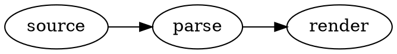

# Graphviz Diagram Preview

Renders [Graphviz](https://graphviz.org) (DOT) code blocks as diagrams in Obsidian, in Reading
view and Live Preview. A port of the VS Code extension of the same name.

## Usage

Write DOT source in a code block tagged `graphviz`:

~~~markdown

~~~

Only `graphviz` blocks are claimed; `dot` blocks are left alone. To use another layout engine,
set it inside the source, e.g. `layout=neato`.

## Fence attributes

A `graphviz` fence may carry an attribute block:

~~~markdown
```graphviz {alt="Three stages, left to right" caption="Figure 1: Pipeline" align="center"}
digraph { rankdir=LR; source -> parse -> render }
```
~~~

- `alt`: a description for readers who cannot see the diagram.
- `caption`: plain text shown beneath the diagram.
- `align`: `left`, `center` or `right`.
- `class`: an extra CSS class on the `<svg>`, alongside the built-in `graphviz` class.

Values must be quoted, with single or double quotes; a backslash escapes a matching quote or a
backslash. Values are plain text, never Markdown or HTML. A mistyped or malformed attribute
never costs you the diagram: it is ignored, and with **Debug logging** on (plugin settings) a
note about it is written to the developer console.

Attributes are read from the note's text. Where Obsidian renders a block without its note (some
embeds and exports), the diagram renders bare.

## Viewing the source

The plugin follows Obsidian's own handling of Mermaid diagrams:

- **Live Preview:** hovering a diagram shows Obsidian's **Edit this block** button in its top
  corner, which opens the code block for editing, as for Mermaid. Live Preview always shows the
  diagram.
- **Reading view:** hovering a diagram shows a button of the same look in the same corner,
  **Show source**, which flips the block to its source text; **Show diagram** flips it back. A
  flipped block stays flipped across re-renders, reopening the note and restarting Obsidian, and
  in every Reading view of the note. Two blocks with the same body are told apart by their order.
  **Show every diagram in this note** in the command palette flips them all back.

## Errors and limits

A DOT syntax error is shown in place of the diagram, with the offending source line. Layout is
limited to 3 seconds per diagram (adjustable in settings, from half a second to a minute) and
64 000 characters of source; a graph that takes longer shows a timeout message until its source
changes or the renderer is restarted. Graphviz warnings (unknown shapes, fonts without metrics)
never appear in the note; with **Debug logging** on they go to the developer console, once per
diagram.

Diagrams follow the theme, as Mermaid diagrams do. In a dark theme they sit on the page in
dark-theme colours: lines and text are lightened only as far as needed to read, filled shapes are
darkened, and hues are kept, so colours that already read on a dark page stay as they are.
Graphviz's default white background gives way to the page, and every label is checked against
what it sits on: its node's or cluster's fill, or the page for edge labels and unfilled nodes. A
graph that sets its own `bgcolor` (in the graph's body or in `graph [...]`) keeps exactly its
author's colours on its own background in every theme. In a light theme diagrams sit on a white
card with their exact colours. To keep every diagram on a white card, turn off **Follow dark
themes** in the plugin's settings.

Links (`URL`, `href`) work for `http:`, `https:` and `mailto:` and open in your browser; other
links are removed but the node stays. Images (`image=`, ``) are not supported. The
plugin reads no files.

## Fonts

Graphviz measures text with built-in width tables, so labels fit their shapes only for these
families: Times / Times New Roman, Helvetica / Arial, Courier / Courier New, DejaVu Sans,
Consolas, Nunito, Trebuchet. Other fonts are measured as Times, with a warning. Name a single
family: a CSS-style list such as `fontname="Helvetica,Arial,sans-serif"` or a generic family
such as `sans-serif` is measured as Times.

## Settings and commands

- **Layout time limit**: seconds per diagram, 0.5 to 60; default 3. Changing it restarts the
  renderer.
- **Follow dark themes**: on by default; off keeps the white card with exact colours in dark
  themes too.
- **Debug logging**: ignored attributes and Graphviz warnings in the developer console.
- **Restart renderer** (command): a fresh Graphviz worker, and every open note drawn again.
- **Show every diagram in this note** (command): flips every block of the note back to its
  diagram in Reading view.

## How it renders

Rendering runs in a Web Worker inside Obsidian, built from
[graphviz-renderer](https://github.com/Reonarudo/graphviz-renderer): Graphviz 16.0.0 compiled to
WebAssembly by viz-js 3.30.0, and an allowlist sanitizer for its SVG. Nothing is downloaded,
installed or written to disk; the worker is embedded in `main.js`, which is why that file is
about 1.9 MB.

The worker starts with the first diagram drawn, so a vault without graphviz blocks never loads
the engine. Diagrams also draw in embedded notes, hover previews, Canvas cards and exported PDFs (in light colours). Settings
appear in Obsidian's settings search on 1.13 and later. On an Obsidian whose built-in Chromium
predates `light-dark()`, diagrams keep the white card in dark themes.

Works on desktop and on Obsidian's mobile apps, where the source button stays visible (there is
no hover to reveal it). Nothing in the plugin needs Node or Electron. On a phone, mind the size:
`main.js` is about 2 MB, almost all of it the Graphviz engine, which is compiled when the first
diagram is drawn; a very large graph lays out in the phone's memory with only the time limit to
stop it.

## Development

Requires Node 22 or newer (see `.nvmrc`).

~~~sh
npm ci
npm run lint        # tsc --noEmit
npm test            # node --test: attributes, toggle, scanner, DOM, cache, host, and the real worker bundle
npm run build       # main.js, with the worker bundle embedded
npm run vault       # link this repo into ../test-vault as an enabled plugin
npm run test:live   # a real Obsidian with a throwaway profile and vault, driven over CDP
~~~

`npm run test:live` needs Obsidian installed (`OBSIDIAN_EXECUTABLE` overrides the path); it
prints where it saved light and dark screenshots.

The renderer is pinned to a release tarball in `package.json` (`.npmrc` sets
`allow-remote=root` for npm 12). To take a new release, edit the URL, run `npm install`, check
`src/worker/entry.ts` against the release's `src/worker.ts`, and run the tests;
`test/worker.test.ts` compares the bundle's results with the library's own, byte for byte.

## License

MIT for this plugin; Graphviz, embedded in `main.js` through graphviz-renderer, is EPL-2.0. See
[THIRD_PARTY_NOTICES.md](THIRD_PARTY_NOTICES.md).
