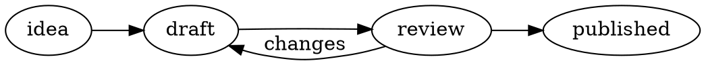

# Graphviz Diagram Preview

Draw graphs in your notes with [Graphviz](https://graphviz.org) and its DOT language. Write a
`graphviz` code block and the graph appears in its place, in Reading view and Live Preview, on
desktop and mobile. No Graphviz installation needed.

~~~markdown

~~~

## Features

- Graphs in Reading view, Live Preview, embedded notes, hover previews, Canvas cards and exported
  PDFs.
- Captions, alignment and alt text for each graph.
- Clickable links in nodes and edges.
- A button to see a graph's code without leaving Reading view.
- Follows your theme: graphs stay readable in dark themes.
- Works offline. Graphviz is built into the plugin.

## Install

1. In Obsidian, open **Settings → Community plugins** and turn off **Restricted mode** if it's on.
2. Select **Browse**, search for **Graphviz Diagram Preview**, then select **Install** and
   **Enable**.

To install by hand instead, download `main.js`, `manifest.json` and `styles.css` from the
[latest release](https://github.com/Reonarudo/graphviz-diagram-preview/releases/latest) into
`<your vault>/.obsidian/plugins/graphviz-diagram-preview/`, then enable the plugin.

## Writing graphs

Put DOT code in a code block tagged `graphviz`. Blocks tagged `dot` are left as plain code. The
[DOT language guide](https://graphviz.org/doc/info/lang.html) explains the syntax. To use another
layout engine, set it in the graph, for example `layout=neato`.

### Captions and other options

Add options in braces after `graphviz`:

~~~markdown
```graphviz {caption="Figure 1: Publishing" align="center" alt="Four stages from idea to published"}
digraph { rankdir=LR; idea -> draft -> review -> published }
```
~~~

| Option | What it does |
| --- | --- |
| `caption` | Text shown under the graph. |
| `align` | `left`, `center` or `right`. |
| `alt` | A description read aloud by screen readers. |
| `class` | A CSS class, for styling the graph with a CSS snippet. |

Put each value in quotes. Values are plain text, not Markdown. If an option is misspelled, it's
ignored and the graph still appears.

### Links

Nodes and edges with a `URL` or `href` open in your browser when selected. Links to `http:`,
`https:` and `mailto:` addresses work; other links are removed and the node stays.

### Fonts

Labels fit their shapes best in these fonts: Times, Helvetica or Arial, Courier, DejaVu Sans,
Consolas, Nunito and Trebuchet. Graphviz measures other fonts as Times, so long labels may
overflow. Name a single font, such as `fontname="Helvetica"`, not a list.

## Viewing the code

- **Reading view:** hover over a graph and select the **</>** button in its corner to see the
  code. Select it again to see the graph. Obsidian remembers which graphs you switched, even after
  a restart. **Show every diagram in this note** in the command palette switches them all back.
- **Live Preview:** select Obsidian's own **Edit this block** button, just as for a Mermaid
  diagram.
- **Phones and tablets:** the button is always visible.

## Dark and light themes

Graphs follow your theme. In a dark theme, lines and labels are lightened just enough to read,
filled shapes are darkened, colours keep their hue, and the white background disappears. In a
light theme, graphs appear on a white card with their exact colours.

A graph that sets its own background with `bgcolor` always keeps its exact colours. To do the same
for every graph, turn off **Follow dark themes** in the plugin's settings.

## Settings

| Setting | What it does |
| --- | --- |
| **Layout time limit** | How long a graph's layout may take before it's shown as an error. 3 seconds by default, from 0.5 to 60. |
| **Follow dark themes** | On by default. Turn off to keep every graph on a white card. |
| **Debug logging** | Writes ignored options and Graphviz warnings, such as unknown fonts, to the developer console. |

## Commands

| Command | What it does |
| --- | --- |
| **Show every diagram in this note** | Switches every block in the note back from code to graph. |
| **Restart renderer** | Starts Graphviz afresh and redraws open notes. |

## When something goes wrong

- **A mistake in the code:** the error and the line it's on appear in place of the graph. Fix the
  code and the graph comes back.
- **"Took longer than…":** the layout hit the **Layout time limit**. Simplify the graph, or raise
  the limit in settings.
- **Images:** `image=` and `` in labels aren't supported.
- **Large blocks:** a block may hold up to 64,000 characters.

## Privacy

Graphs are drawn on your device, inside Obsidian. The plugin doesn't connect to the internet,
doesn't collect any data, and doesn't read or write any files. Links in a graph open in your
browser only when you select them.

## Credits

Graphs are drawn by [Graphviz](https://graphviz.org), through [Viz.js](https://github.com/mdaines/viz-js).
The licenses of the software built into this plugin are listed in
[THIRD_PARTY_NOTICES.md](THIRD_PARTY_NOTICES.md).

Released under the [MIT License](LICENSE). To build or change the plugin, see
[DEVELOPMENT.md](DEVELOPMENT.md).
