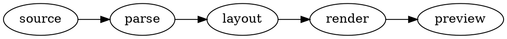
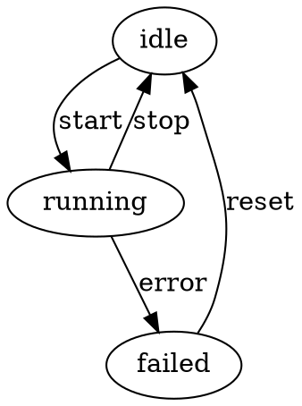
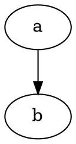
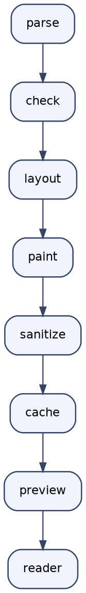
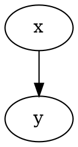
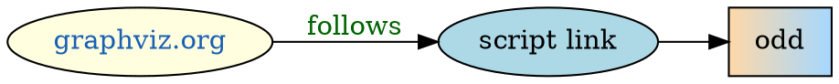
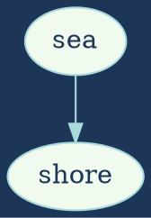

# The view toggle

In Reading view, hovering a `graphviz` code block below shows a button in its top corner that
flips it between the diagram and the block's source. In Live Preview the same corner holds
Obsidian's own "Edit this block" button, as for Mermaid. This note is the fixture for
`npm run test:live` and the document for the manual checklist: open it in Reading view and in
Live Preview, in a light and a dark theme.

## 1. A plain fence



## 2. Captioned, centred: the button stays at the column edge



## 3. Right-aligned with alt: the card sits under the button



## 4. Error card: the offending line is echoed, the source view shows the body alone

```graphviz
digraph broken {
  a -> ;
}
```

## 5. Long lines and a tall body: horizontal scroll, height jump



## 6. Two identical bodies: flip the second one only, then edit this heading




## 7. An ordinary fence: no toggle, Obsidian's own copy button

```json
{ "compare": "Obsidian's copy button on hover, no view toggle" }
```

## 8. In a list item and a callout: attributes still apply

- A list item holding a diagram:

    ```graphviz {caption="Inside a list item"}
    digraph listed { a -> b }
    ```

> [!note] A callout
> ```graphviz {caption="Inside a callout" align="center"}
> digraph quoted { rankdir=LR; q -> r }
> ```

## 9. Quirks: links, colours and warnings



The `graphviz.org` node is a link and opens in the browser; the `javascript:` link is removed
by the renderer's sanitizer, but its node stays. The unknown shape is drawn as a box; Graphviz's
warning about it goes to the developer console when **Debug logging** is on, never into the note.
In a dark theme the diagram follows the theme as Mermaid's do: lines and text are lightened just
enough to read, the pale fills darkened, hues kept. A graph that takes longer than the layout
limit shows a timeout card, which the toggle treats like any error card.

## 10. An author's own background: exact colours in every theme



A graph that sets its own `bgcolor` keeps exactly the colours its author chose, on its own
background, in a light and a dark theme alike.
